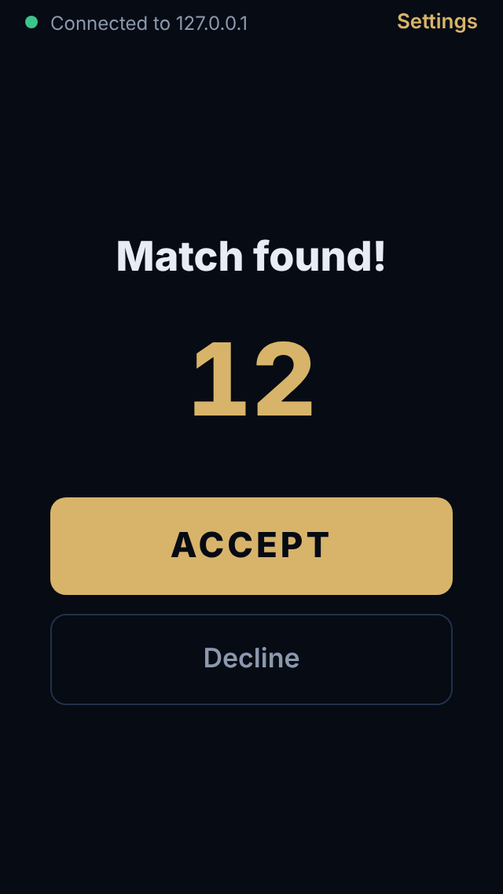
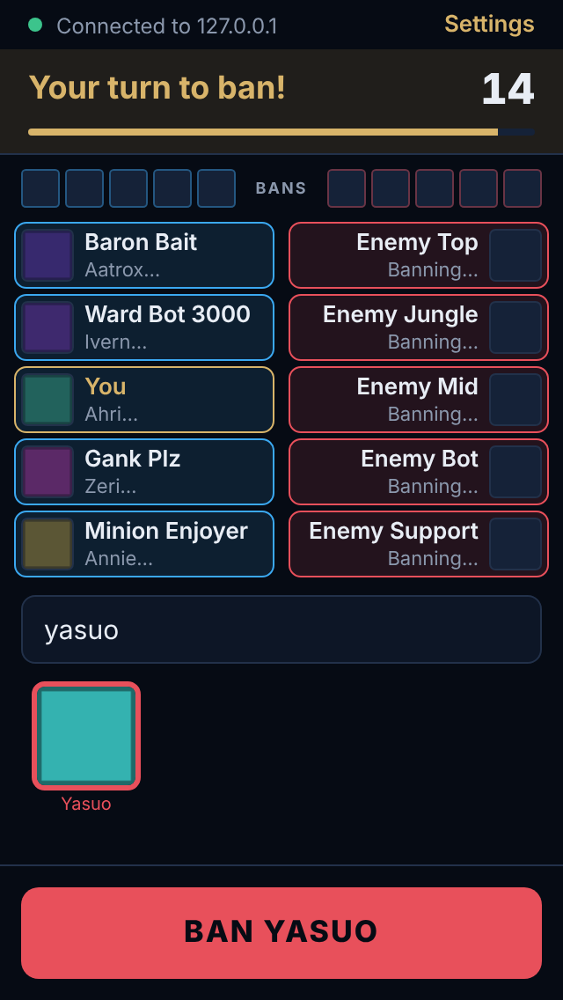
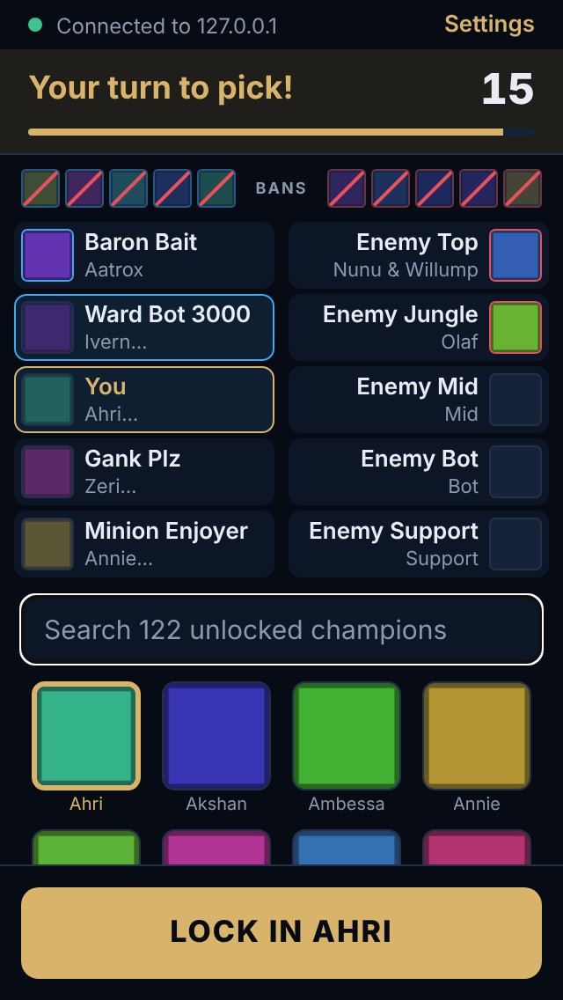
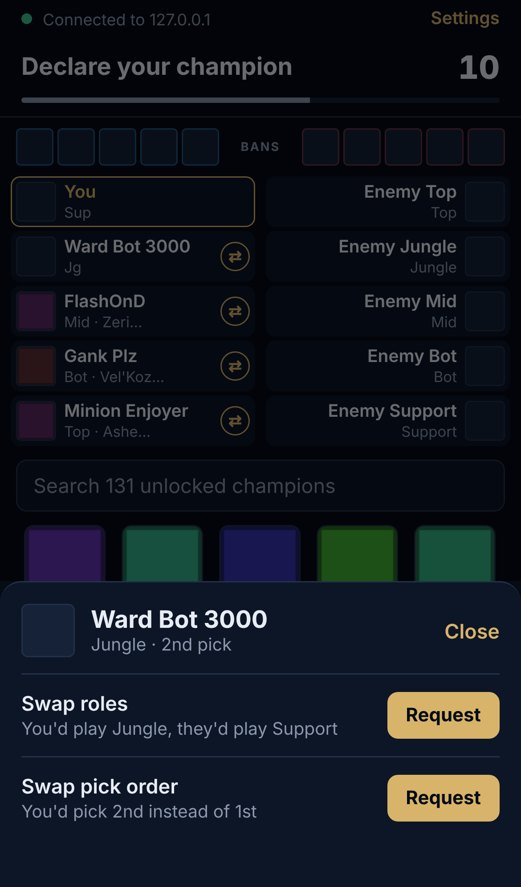
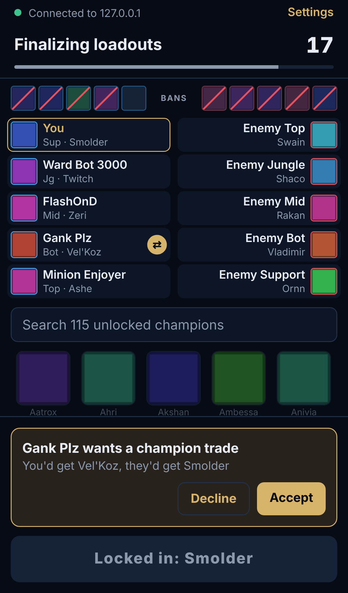

# Champ Select Remote

Do champ select from your phone when you're away from your computer. You can:

- **accept the ready check** when a match is found
- see **both teams' picks**, your teammates' hovers, and **ally and enemy bans**, with the phase timer
- browse **your unlocked champions** (owned plus free rotation), search them, **hover** one, and **lock in** or **ban**
- **swap with teammates**: trade **roles**, **pick order** or **locked-in champions**, and accept or decline their requests
- **ARAM**: choose one of your **champion cards**, then take champions from the shared **bench**

<p>
  
  
  
</p>
<p>
  
  
</p>

<sub>These screenshots come from the built-in mock client, so champion icons are coloured placeholders. With the real client you get the real icons.</sub>

## How it works

```
 ┌──────────────┐    Wi-Fi / LAN     ┌────────────────────┐   localhost    ┌───────────────┐
 │  Phone app   │ ◀───────────────▶  │ Companion (your PC)│ ◀────────────▶ │ League Client │
 │ (Expo / RN)  │  WebSocket + token │  Node.js           │   LCU API      │               │
 └──────────────┘                    └────────────────────┘                └───────────────┘
```

Riot's public web API ([developer.riotgames.com](https://developer.riotgames.com)) **does not expose champ select**.
Champ select lives only in the League Client's local API (the "LCU" API). That API listens on `127.0.0.1` with a
random port and password, so your phone can't reach it directly.

That's why the project has two parts:

| Folder | What it is |
|---|---|
| [`companion/`](companion) | A small Node.js program that runs on the same PC as League. It finds the client's port and password, subscribes to champ select / ready check / gameflow events over the client's WebSocket, and re-serves a simplified live state to your phone. Commands from the phone (hover, lock in, ban, accept) become LCU calls. Champion icons are proxied from the client too. |
| [`mobile/`](mobile) | An Expo (React Native) app for iOS and Android. You pair it with the companion once (scan a QR code), and from then on it follows the client: lobby → queue → ready check → champ select → in game. |

## Quick start

### 1. Run the companion on your PC

Requires [Node.js](https://nodejs.org) 22 or newer.

```bash
cd companion
npm install
npm start
```

It prints a QR code plus a host, port and pairing code. Leave it running. It finds the League Client on its own,
whether you start League before or after it. The first time, Windows may ask whether Node.js can use the network:
allow it on **private networks** so the phone can connect.

Options: `npm start -- --port 9000`, `--lockfile "<path to League>/lockfile"` if detection fails, and
`--reset-token` to un-pair every phone.

### 2. Run the app on your phone

```bash
cd mobile
npm install
npx expo start
```

Scan the Expo QR code with **Expo Go** ([iOS](https://apps.apple.com/app/expo-go/id982107779) /
[Android](https://play.google.com/store/apps/details?id=host.exp.exponent)). In the app, tap **Scan QR code** and scan
the companion's QR code, or type the host, port and code by hand. The phone needs to be on the same Wi-Fi as the PC.

To install the app for real, without Expo Go, build it in Expo's cloud with EAS (needs a free
[Expo account](https://expo.dev/signup)):

```bash
cd mobile
npx eas-cli@latest build -p android --profile preview
```

The `preview` profile builds an `.apk`. When the build finishes, open the link it prints (or scan its QR code) on your
Android phone, download the APK and install it. Android will ask you to allow installs from your browser the first
time. For iOS, use `-p ios`; that needs an Apple Developer account. For a personal build you can leave `package` and
`bundleIdentifier` in `mobile/app.json` as they are. Change them before publishing anywhere.

### Try it without League running

The companion includes a fake League Client. It runs lobby → queue → ready check → a ranked-style draft with bot
teammates and enemies, and loops forever. Bot teammates also answer your swap requests (and accept most of them), ask you for a role swap
during planning, and offer a champion trade during finalization:

```bash
cd companion
npm run dev:mock                 # mock client and companion together
npm run dev:mock -- --speed 3    # everything 3x faster
npm run dev:mock -- --mode aram  # ARAM: champion cards and a shared bench
```

Pair the phone with it the same way. Your own turns wait for you, just like the real thing.

## Swaps and trades

When a swap with a teammate is possible, a **⇄** badge appears on their row. Tap the row to see what's on offer, with
what you'd end up with if they accept:

| Swap | When the client offers it | Effect |
|---|---|---|
| **Swap roles** | Ranked queues with assigned positions, usually during the planning phase | You exchange assigned positions |
| **Swap pick order** | Before either of you has started picking | You exchange pick turns; each of you keeps your hover |
| **Trade champions** | After both of you have locked in, until the game starts | You exchange locked-in champions (you both need to own them) |

When a teammate sends you a request, a banner appears above the lock-in button with **Accept** and **Decline**, and
the phone vibrates. While your own request is pending, the banner shows **Cancel request**. Only one swap can be pending
at a time; while one is, other players show as busy.

The companion doesn't decide what's allowed. It shows exactly the swaps the League Client reports as available.
Which swaps you get depends on the queue.

## Using it away from home

The phone talks to your PC directly. If you're on the same Wi-Fi (couch, kitchen, bathroom), it just works.
To use it from somewhere else, put both devices on a private VPN such as [Tailscale](https://tailscale.com). Then pair
using the PC's Tailscale IP (`100.x.y.z`); the companion lists it under "other addresses". **Don't port-forward the
companion to the internet.**

## Security

- The companion only accepts connections that present the pairing code: 6 random characters (not case-sensitive)
  stored in `~/.lol-champ-select/config.json`. After 10 wrong codes, that address is locked out for a minute, so
  the code can't be guessed. Anyone on your network who has the code can control your champ select. Use
  `--reset-token` if it leaks.
- Traffic between phone and PC is plain `ws://` on your LAN, so only use it on networks you trust (or over Tailscale,
  which encrypts it).
- The companion only ever talks to the League Client on `127.0.0.1`.

## Development

```bash
cd companion && npm test          # unit tests plus an end-to-end draft against the mock client
cd companion && npm run typecheck
cd mobile && npm run typecheck
```

The phone ↔ companion messages are defined in `companion/src/protocol.ts`, and `mobile/src/protocol.ts` is a copy of
it. Keep the two in sync.

LCU endpoints used:

| Purpose | Endpoint |
|---|---|
| Live updates | WAMP subscribe to `OnJsonApiEvent_lol-champ-select_v1_session`, `…_lol-gameflow_v1_gameflow-phase`, `…_lol-matchmaking_v1_ready-check` |
| Champ select state | `GET /lol-champ-select/v1/session` |
| Unlocked / bannable champions | `GET /lol-champ-select/v1/pickable-champion-ids`, `GET /lol-champ-select/v1/bannable-champion-ids` |
| Hover / lock in / ban | `PATCH /lol-champ-select/v1/session/actions/{id}` with `{ championId }` or `{ championId, completed: true }` |
| Swaps and trades | `POST /lol-champ-select/v1/session/{position-swaps,pick-order-swaps,champion-swaps}/{id}/{request,accept,decline,cancel}`; availability comes from the session's `positionSwaps`, `pickOrderSwaps` and `trades` arrays (champion trades are listed under `trades` but use the `champion-swaps` endpoint) |
| ARAM champion cards | `GET /lol-lobby-team-builder/champ-select/v1/subset-champion-list` when the session has `allowSubsetChampionPicks`; the chosen card is locked through your pick action |
| ARAM bench | Session `benchEnabled` / `benchChampions`; `POST /lol-champ-select/v1/session/bench/swap/{championId}` |
| Ready check | `POST /lol-matchmaking/v1/ready-check/accept` and `/decline` |
| Champion names and icons | `/lol-game-data/assets/v1/champion-summary.json`, `/lol-game-data/assets/v1/champion-icons/{id}.png` |
| Teammate names | `GET /lol-summoner/v2/summoners/puuid/{puuid}` |

## Not included yet

Ideas for later: rune page and summoner spell editing, Arena's 16-player layout, and push notifications while the app
is in the background.

Run the companion with `npm start -- --debug` to log every League Client event it receives and save the latest raw
champ select session to `~/.lol-champ-select/debug/champ-select-session.json`. That's the quickest way to see what an
unfamiliar game mode sends. For now, keep the app open (it keeps the screen awake during queue
and champ select, and vibrates when it's your turn).

## Disclaimer

The LCU API is unofficial and undocumented. Riot can change it at any time, and it can break with a client patch.
This tool only does what you tap; it never picks or bans for you on its own. Even so, read
[Riot's third-party tool policies](https://developer.riotgames.com/policies/general) and use it at your own risk.

Champ Select Remote isn't endorsed by Riot Games and doesn't reflect the views or opinions of Riot Games or anyone
officially involved in producing or managing Riot Games properties. Riot Games, and all associated properties are
trademarks or registered trademarks of Riot Games, Inc.
